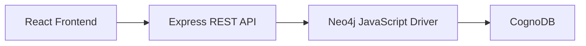
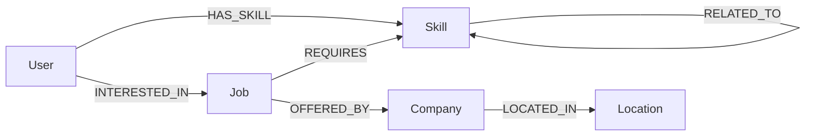

# CareerGraph — Job & Skill Relationship Explorer

CareerGraph helps users discover jobs, missing skills, related technologies, and career paths through graph relationships powered by CognoDB. Users select their current skills, explore related technologies, and visualize how those skills connect to jobs, companies, and locations.

## Why a Graph Database?

CareerGraph is centered around relationships:

- User → HAS_SKILL → Skill
- Job → REQUIRES → Skill
- Skill → RELATED_TO → Skill
- Job → OFFERED_BY → Company
- Company → LOCATED_IN → Location

Questions like "If I know React, what related skills could unlock additional jobs, and which companies offer those jobs?" naturally require traversing several connected entities. A graph model expresses these multi-hop traversals directly as pattern matches. A relational design would require multiple tables, junction tables, and joins for the same connected-data questions. Graph databases make relationship-heavy traversal more natural and easier to express, especially as the depth and breadth of connections grow.

## Key Features

- Skill selection with search and chips
- Job recommendations with match percentage
- Matched and missing skills per job
- Job explorer with search and filters
- Job details with skill gap analysis
- Related skills discovery
- Multi-hop career path exploration
- Graph-native opportunity discovery
- Interactive force-directed graph visualization
- Loading, empty, and error states
- Responsive UI for desktop, tablet, and mobile

## Technology Stack

**Frontend**
- React + Vite
- Tailwind CSS
- React Router
- Axios
- Lucide React
- react-force-graph-2d

**Backend**
- Node.js + Express.js
- Neo4j JavaScript Driver

**Database**
- CognoDB (openCypher-compatible, Bolt protocol)

## Architecture



The React frontend communicates exclusively with the Express REST API. The backend uses the official Neo4j driver to execute parameterized Cypher queries against CognoDB.

## Graph Data Model



### Node Labels

| Label | Key Properties |
|-------|---------------|
| `User` | `id`, `name` |
| `Skill` | `id`, `name`, `category` |
| `Job` | `id`, `title`, `description`, `experienceLevel`, `employmentType`, `salaryMin`, `salaryMax` |
| `Company` | `id`, `name`, `industry`, `website` |
| `Location` | `id`, `city`, `state` |

### Relationship Types

- **(User)-[:HAS_SKILL {level}]->(Skill)** — Tracks user skill proficiency (`Beginner`, `Intermediate`, `Advanced`).
- **(User)-[:INTERESTED_IN]->(Job)** — Captures a user's career interest in a specific job.
- **(Job)-[:REQUIRES {importance}]->(Skill)** — Defines skill requirements (`Required` or `Preferred`).
- **(Job)-[:OFFERED_BY]->(Company)** — Links a job posting to the hiring company.
- **(Company)-[:LOCATED_IN]->(Location)** — Associates a company with a geographic location.
- **(Skill)-[:RELATED_TO {strength}]->(Skill)** — Models skill adjacency. `strength` is a numeric value representing how closely two skills are related.

### Multi-Hop Traversal

Career path discovery uses a bounded multi-hop graph traversal:

```
Selected Skill
→ RELATED_TO
→ Related Skill
← REQUIRES
← Job
→ OFFERED_BY
→ Company
→ LOCATED_IN
→ Location
```

This powers career-path exploration and the interactive graph visualization. A conceptual Cypher pattern for this traversal:

```cypher
MATCH (start:Skill)
WHERE start.name IN $skills
MATCH (start)-[r:RELATED_TO]->(related:Skill)
MATCH (related)<-[req:REQUIRES]-(j:Job)
MATCH (j)-[:OFFERED_BY]->(c:Company)
MATCH (c)-[:LOCATED_IN]->(l:Location)
RETURN start, related, r, j, c, l
```

### Graph-Native Opportunity Discovery

The opportunities query demonstrates graph traversal by:
1. Starting from selected skills
2. Following `RELATED_TO` to nearby skills (bounded depth)
3. Finding jobs requiring either direct or related skills
4. Finding companies and locations for those jobs
5. Tagging each opportunity as a direct match or discovered-through-related skill

This avoids the multiple joins that a relational design would need for the same connected-data walk.

### Parameterized Cypher Queries

All dynamic request values are passed as Neo4j driver parameters rather than being concatenated into Cypher strings:

```javascript
session.run(
  `
  MATCH (s:Skill)
  WHERE s.name IN $skills
  RETURN s
  `,
  { skills }
)
```

This improves safety and maintainability.

## Seed Data

The repository includes a repeatable seed script that populates the graph with demonstration data:

```bash
cd server
npm run seed
```

Approximate dataset:
- 1 demo user
- 30 skills
- 25 jobs
- 15 companies
- 8 locations
- 192 relationships

The seed uses idempotent logic where applicable and does not create uncontrolled duplicates on repeated runs.

A development-only reset command is also available:

```bash
npm run seed:reset
```

**Note:** `seed:reset` clears all CareerGraph application data and is intended for local development only. It is not exposed as a public API endpoint.

## Project Structure

```text
careergraph/
├── client/
│   ├── index.html
│   ├── package.json
│   ├── vite.config.js
│   ├── tailwind.config.js
│   ├── postcss.config.js
│   ├── .env.example
│   └── src/
│       ├── components/
│       │   ├── CareerGraph.jsx
│       │   ├── JobCard.jsx
│       │   ├── RecommendationCard.jsx
│       │   ├── SkillSelector.jsx
│       │   ├── SkillBadge.jsx
│       │   ├── Navbar.jsx
│       │   ├── Footer.jsx
│       │   ├── LoadingState.jsx
│       │   ├── ErrorState.jsx
│       │   └── EmptyState.jsx
│       ├── pages/
│       │   ├── HomePage.jsx
│       │   ├── JobsPage.jsx
│       │   ├── JobDetailsPage.jsx
│       │   ├── CareerPathsPage.jsx
│       │   ├── AboutPage.jsx
│       │   └── NotFoundPage.jsx
│       ├── services/
│       │   └── api.js
│       ├── context/
│       │   └── SelectedSkillsContext.jsx
│       ├── hooks/
│       │   └── usePageTitle.js
│       ├── utils/
│       │   └── index.js
│       ├── App.jsx
│       ├── main.jsx
│       └── index.css
├── server/
│   ├── package.json
│   ├── server.js
│   ├── .env.example
│   └── src/
│       ├── config/
│       │   └── db.js
│       ├── controllers/
│       │   ├── jobController.js
│       │   ├── skillController.js
│       │   ├── recommendationController.js
│       │   └── careerPathController.js
│       ├── routes/
│       │   ├── index.js
│       │   ├── jobRoutes.js
│       │   ├── skillRoutes.js
│       │   ├── recommendationRoutes.js
│       │   └── careerPathRoutes.js
│       ├── services/
│       │   ├── jobService.js
│       │   ├── skillService.js
│       │   ├── recommendationService.js
│       │   ├── careerPathService.js
│       │   └── opportunityService.js
│       ├── queries/
│       │   ├── jobQueries.js
│       │   ├── skillQueries.js
│       │   ├── recommendationQueries.js
│       │   ├── careerPathQueries.js
│       │   ├── opportunityQueries.js
│       │   └── schemaQueries.js
│       └── scripts/
│           ├── seedDatabase.js
│           ├── resetDatabase.js
│           └── setupSchema.js
├── .gitignore
└── README.md
```

## Prerequisites

- Node.js >= 18
- npm
- CognoDB Cloud account
- Git (for cloning)

## CognoDB Setup

1. Go to [CognoDB Cloud](https://cognodb.com) and create an account.
2. Create a free c0 instance.
3. Choose a region.
4. Save the generated Bolt connection URI.
5. Save the generated password for user `cognodb`.
6. Never commit the password to version control.

## Environment Variables

### Backend (`server/.env`)

```env
COGNODB_URI=bolt+s://your-instance.databases.cognodb.com
COGNODB_USERNAME=cognodb
COGNODB_PASSWORD=
PORT=5000
Frontend (Vercel): https://wex-liart.vercel.app
Backend (Render): https://wex-x2ah.onrender.com
```

### Frontend (`client/.env`)

```env
Frontend (Vercel): https://wex-liart.vercel.app
```

**Never commit `.env`.** The repository already excludes `.env` via `.gitignore`. Use `.env.example` as a template.

## Installation

```bash
git clone https://github.com/harish-2807/wex.git
cd careergraph
```

### Backend

```bash
cd server
npm install
cp .env.example .env
# Fill in your CognoDB credentials in .env
```

### Frontend

```bash
cd ../client
npm install
```

## Schema Setup

Create database constraints and indexes:

```bash
cd server
npm run dev
```

Then call:

```bash
curl -X POST http://localhost:5000/api/schema/setup
```

**Note:** The schema setup endpoint is intended for development and initial setup only. It is not exposed through the frontend.

## Load Seed Data

Populate the graph with demonstration data:

```bash
cd server
npm run seed
```

To clear and reseed during development:

```bash
npm run seed:reset
npm run seed
```

## Run the Application

### Backend

```bash
cd server
npm run dev
```

Backend runs at: `http://localhost:5000`
Health check: `http://localhost:5000/api/health`

### Frontend

```bash
cd client
npm run dev
```

Frontend runs at: `http://localhost:5173`

## Main API Endpoints

| Method | Endpoint | Description |
|--------|----------|-------------|
| GET | `/api/health` | Health and database connectivity check |
| GET | `/api/skills` | List all skills |
| GET | `/api/skills/:id` | Get skill details |
| GET | `/api/skills/:id/related` | Get related skills |
| GET | `/api/jobs` | List all jobs with company, location, and required skills |
| GET | `/api/jobs/:id` | Get job details |
| GET | `/api/jobs/:id/missing-skills` | Get matched and missing skills for a job |
| GET | `/api/recommendations` | Get job recommendations based on selected skills |
| GET | `/api/career-paths` | Get multi-hop career path traversals |
| GET | `/api/opportunities` | Get graph-native opportunity discovery |
| POST | `/api/schema/setup` | Create constraints and indexes (development only) |

## Error Handling

The application handles CognoDB unavailability, invalid requests, missing jobs or skills, and empty results gracefully. Database credentials and raw stack traces are not exposed to the frontend. Error responses follow a consistent JSON shape.

## Security Notes

- Credentials are stored in environment variables (`.env`), never in source code.
- `.env` is excluded from Git.
- All dynamic Cypher queries use parameterized values.
- The frontend never connects directly to CognoDB.
- Graph traversals are bounded (no unbounded `[*]` patterns).
- CORS is configured to the frontend origin via `CLIENT_URL`.
- Database failures return clean JSON without internal details.

## Screenshots

Screenshots will be added after final testing and review.

| Page | Screenshot |
|------|-----------|
| Home / Skill Selection | `docs/screenshots/home.png` |
| Job Recommendations | `docs/screenshots/recommendations.png` |
| Job Explorer | `docs/screenshots/jobs.png` |
| Career Graph | `docs/screenshots/career-graph.png` |

## Live Demo

- Live Application: `To be added after deployment`
- Screen Recording: `To be added after recording`

## Deployment

### Architecture

- **Frontend:** Vercel (React + Vite)
- **Backend:** Render (Node.js + Express)
- **Database:** CognoDB Cloud

### Prerequisites

- A GitHub repository (this repo: `https://github.com/harish-2807/wex.git`)
- A Vercel account
- A Render account
- A CognoDB Cloud instance with saved connection URI and password

### Important Notes

- The schema setup endpoint (`POST /api/schema/setup`) is available only in development. After local setup, it is inaccessible in production on Render.
- Never commit `.env` files. Store secrets in Render/Vercel environment variable settings.
- The frontend calls the backend exclusively via `VITE_API_URL`. The frontend never connects directly to CognoDB.


## Assignment Context

This project was built as a take-home graph database application to demonstrate relationship-heavy querying, multi-hop traversal, and interactive graph visualization using CognoDB.

## License

MIT
